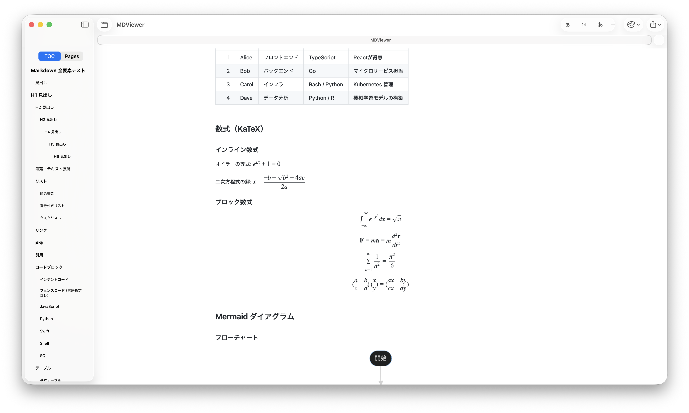

# MDViewer

開発者向けの軽量ネイティブ macOS Markdown ビューア。



## 概要

MDViewer は、ターミナルから Claude Code や Codex などのツールを使って作業する際に `.md` ファイルを素早く・シンプルに読みたいというニーズから生まれました。ブラウザやフルエディタのオーバーヘッドなしに、美しく Markdown をレンダリングします。

もともとビューアとして作りましたが、やっぱり編集機能も欲しくなったので、分割ビューエディタを内蔵しました。

## 機能

- **即時レンダリング** — Markdown ファイルをすぐに開いて表示
- **ライブリロード** — ファイルの変更を監視し、保存のたびに自動再表示
- **目次サイドバー** — 見出しから自動生成、スムーズスクロール対応
- **シンタックスハイライト** — [Shiki v1](https://github.com/shikijs/shiki) による 27 言語対応
- **コードブロックのコピーボタン** — コードブロックにマウスを重ねると表示されます
- **テーマとフォント** — 6種類のテーマに加え、本文・見出し・コードのフォントをそれぞれ選べます（設定 > Appearance）
- **数式表示** — [KaTeX](https://github.com/KaTeX/KaTeX) によるインライン・ブロック LaTeX
- **Mermaid 図** — フローチャート、シーケンス図、ガントチャートなど
- **脚注** — GitHub と同じ `[^1]` 記法。文書の末尾に一覧で表示し、本文へ戻るリンクを付けます
- **絵文字ショートコード** — `:smile:` など、GitHub のショートコードのうち Unicode の絵文字のものをすべて絵文字で表示（対応表は [gemoji](https://github.com/github/gemoji)。`:octocat:` のような GitHub 独自の画像の絵文字は対象外）
- **スマートリンク** — ローカル `.md` リンクはアプリ内で開き、外部リンクはブラウザへ
- **件数付きの検索** — ⌘F でプレビューを検索し、「3/12」のように何件目か／全件数を表示
- **タブと最近使った項目** — ドキュメントのウィンドウをタブにまとめられます（ウインドウメニューの「すべてのウインドウを結合」、またはシステム設定の「書類を開くときはタブで」）。ファイルメニューの「最近使った項目を開く」から開き直せます
- **書き出しと印刷** — スタイルを保持したワンクリック PDF 出力、HTML 出力、ファイルメニューの「プリント…」（⌘P）
- **署名・公証済み** — Developer ID 署名と Apple 公証に対応

### エディタモード

ツールバーの鉛筆ボタンまたは **⌘E** でエディタモードをON/OFFできます。

- **分割ビュー**: 左にエディタ、右にリアルタイムプレビュー
- **新規作成**: ⌘N・ツールバーのボタン・ウェルカム画面から、エディタモードで空のドキュメントを開始できます
- **保存**: ⌘S で現在のファイルを上書き保存。保存先未定の新規ドキュメントの場合は保存パネルを表示します
- **文字サイズ**: エディタはプレビューと同じ文字サイズで表示します。ツールバー、⌘+ / ⌘− / ⌘0、設定 > Appearance のスライダーで変えられます
- 未保存の変更がある場合、保存ボタンがアクティブになります
- 未保存変更がある状態でウィンドウを閉じる、または新規作成すると「保存・破棄・キャンセル」の確認ダイアログが表示されます

### ヘルプ

ヘルプメニューの「MDViewer ヘルプ」から、Markdown全記法とMermaidの全図種（フローチャート・シーケンス図・クラス図・状態遷移図・ER図・ガントチャート・円グラフ・ユーザージャーニー・マインドマップ・タイムライン）を実例付きで確認できるリファレンスを開けます。

## 動作環境

- macOS 14 Sonoma 以降
- Safari 17.4 以降（Mermaid の図の表示に必要。プレビューは Safari の WebKit で描画されるため、図が表示されない場合は Safari を更新してください）
- Apple Silicon（M1 以降）または Intel の Mac

## インストール

1. [Releases ページ](https://github.com/Masakai/mdviewer/releases/latest) から、お使いの Mac に合った zip をダウンロード
   - Apple Silicon（M1 以降）：`MDViewer-AppleSilicon.zip`
   - Intel：`MDViewer-Universal.zip`（Apple Silicon でも動きます）
2. 解凍して `MDViewer.app` を **アプリケーション** フォルダにドラッグ
3. `.md` ファイルをダブルクリック、または Dock の MDViewer アイコンにドロップ

## ソースからビルド

Xcode 15 以降が必要です。

```sh
git clone https://github.com/Masakai/mdviewer.git
cd mdviewer
open MDViewer.xcodeproj
```

⌘R でビルド・実行。Swift Package の外部依存なし — すべてのベンダーライブラリは `MDViewer/Resources/Web/vendor/` にバンドル済みです。

## 技術スタック

| レイヤー | 技術 |
|---------|------|
| UI フレームワーク | SwiftUI + AppKit |
| レンダリングエンジン | WKWebView |
| Markdown パーサー | [marked](https://github.com/markedjs/marked) v12 |
| HTML サニタイザ | [DOMPurify](https://github.com/cure53/DOMPurify) v3 |
| シンタックスハイライト | [Shiki](https://github.com/shikijs/shiki) v1 |
| 数式 | [KaTeX](https://github.com/KaTeX/KaTeX) v0.18 |
| 図 | [Mermaid](https://github.com/mermaid-js/mermaid) v12 |
| ファイル監視 | `DispatchSource`（kqueue） |

## オープンソースライブラリ

下表のライブラリは、DOMPurify（Apache-2.0 と MPL-2.0 のデュアルライセンスで、Apache-2.0 を選択）を除き MIT ライセンスです。Mermaid の単一ファイル版には Mermaid 自身の依存ライブラリも含まれており、その一部は MIT 以外のライセンス（Apache-2.0、EPL-2.0、ISC、BSD-3-Clause）です。ライセンス全文は [THIRD_PARTY_NOTICES.md](THIRD_PARTY_NOTICES.md) を参照してください。

| ライブラリ | バージョン | ライセンス |
|-----------|-----------|-----------|
| marked | 12.0.2 | MIT |
| Shiki | 1.x | MIT |
| KaTeX | 0.18.9 | MIT |
| Mermaid | 12.0.0 | MIT |
| gemoji（絵文字の対応表） | 4.1.0 | MIT |
| DOMPurify | 3.4.17 | Apache-2.0 |

## ライセンス

MDViewer は [MIT License](LICENSE) のもとで公開されています。

© 2026 Masanori Sakai
